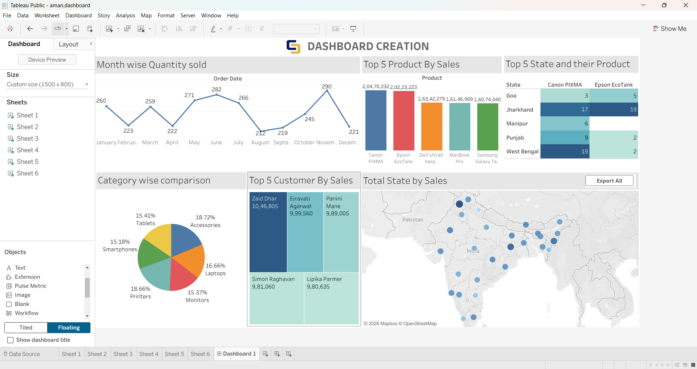

# Tableau Sales Analysis Dashboard
## Project Overview
An interactive sales analysis dashboard built using Tableau Public to explore product performance, customer sales, monthly quantity trends, category distribution, and geographical sales patterns.
## Dashboard Preview

## Key Features
- **Monthly Quantity Analysis:** Tracks quantity sold from January to December.
- **Top 5 Products by Sales:** Compares leading products by sales value.
- **State and Product Comparison:** Examines product quantities across states.
- **Category-wise Comparison:** Visualizes the distribution across product categories.
- **Top 5 Customers by Sales:** Highlights the highest-value customers.
- **Geographical Sales Analysis:** Maps state-level sales performance across India.
## Tools & Technologies
- Tableau Public
- Data Visualization
- Sales Analysis
- KPI Reporting
- Geographical Analysis
## Business Insights
- Identifies products generating the highest sales.
- Highlights top-performing customers.
- Shows monthly changes in quantities sold.
- Compares category-level performance.
- Helps explore regional sales patterns.
tableau-sales-analysis-dashboard/
│
├── README.md
│
├── dashboard/
│   └── Sales_Analysis_Dashboard.twbx
│
├── images/
│   └── dashboard-preview.png
│
└── data/
    └── sales_data.xlsx
## Author
Aman Prasad 
